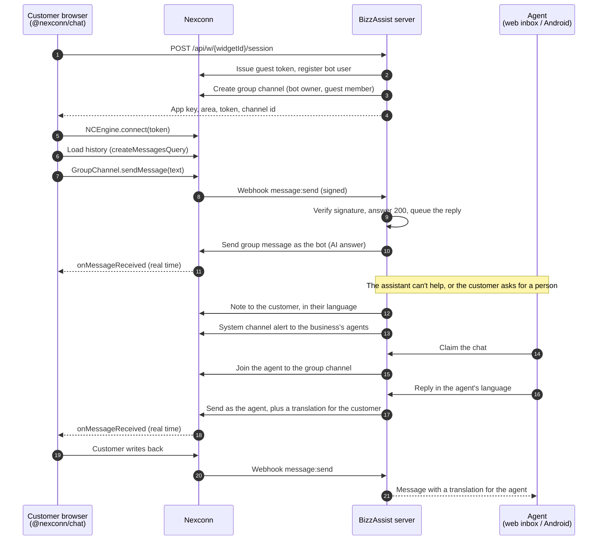

# BizzAssist

AI customer support for small online businesses, built on Nexconn Chat.

A business signs up, adds a chat widget to its website and teaches it from its own pages, documents, Q&A and live order lookups. Customers chat with the assistant in any language. When the assistant can't help, the chat goes to a person on the team, on the web or in the Android agent app. The answers that person gives become new knowledge for the assistant once the owner approves them.

Live at [bizzassist.biz](https://bizzassist.biz). Public usage numbers: [bizzassist.biz/stats](https://bizzassist.biz/stats).

Built for the Nexconn Build Challenge 2026, Marketplace & Support track.

## Features

**Training from several sources**
- Website pages, added one by one or from a sitemap. Onboarding crawls the homepage, the policy pages and the top sitemap entries on its own.
- Documents: PDF, TXT, Markdown or pasted text.
- Q&A pairs with alternative phrasings.
- API actions: the assistant can look up an order or an account through a REST endpoint (headers encrypted at rest) or a Google Sheet. A sheet lookup always asks for two keys, such as order ID and email, so one customer can't read another's data.

**Self-learning loop**
- When an agent resolves a chat, the answers they gave are turned into suggested knowledge.
- The owner approves, edits or rejects each suggestion. Approved answers are used in the next chats, and the Playground shows which source an answer came from.

**Simple to install**
- One script tag puts the chat launcher on any site. The widget takes the brand colour, title, greeting and logo, and can be limited to the business's own domains.
- Every widget also has a direct chat link and a QR code, for shops without a website.

**Multilingual**
- The assistant answers in the language the customer writes in.
- When the customer and the agent speak different languages, each message is translated for the reader. The original stays as written.
- Handover and status notes reach the customer in their own language.

**Human handover**
- The chat goes to a person when the customer asks for one, when the knowledge doesn't cover the question, or when the model fails.
- Agents get an alert, a short summary of the chat so far and the customer's language. Claiming a chat is atomic, so two agents never take the same one.
- The customer can rate the chat when it closes.

**For the owner**
- Analytics: share of chats solved by the assistant, average wait for a person, satisfaction, handover reasons, and the questions the assistant couldn't answer, each with a link to add the answer.
- Team management, Free, Pro and Business plans with their limits, and a Playground to test the assistant before going live.

## How BizzAssist uses Nexconn

Every customer conversation in BizzAssist is a Nexconn group channel. The customer's browser talks to Nexconn through the **Nexconn Chat SDK** (`@nexconn/chat`). The BizzAssist server uses the **Nexconn Platform Chat API** to create users, channels and messages, and receives every new message through a **Nexconn webhook**. The assistant, the customer and the human agent are all real Nexconn users in the same channel.

### One conversation, end to end



### Chat SDK on the client

The customer chat in [`web/app/w/[widgetId]/buyer-chat.tsx`](web/app/w/%5BwidgetId%5D/buyer-chat.tsx) runs on `@nexconn/chat`:

| SDK call | What it does in BizzAssist |
|---|---|
| `NCEngine.initialize({ appKey, areaCode })` | Starts the engine for the app's data center |
| `NCEngine.connect({ token })` | Signs the guest in with the token the server issued |
| `NCEngine.addConnectionStatusHandler` | Shows the connecting and offline states in the chat |
| `NCEngine.addMessageHandler` → `onMessageReceived` | Receives answers from the assistant and the agent in real time |
| `BaseChannel.createMessagesQuery` + `GroupChannelIdentifier` | Loads the conversation history when the chat reopens |
| `new GroupChannel(id).sendMessage(new SendTextMessageParams(...))` | Sends the customer's message |
| `removeMessageHandler`, `removeConnectionStatusHandler`, `disconnect` | Cleans up when the chat closes |

### Platform Chat API and webhook on the server

All server calls go through [`web/lib/nexconn.ts`](web/lib/nexconn.ts). It signs each request with the App Secret (`App-Key`, `Nonce`, `Timestamp`, `Signature`) and falls back to the backup URL of each data center.

| Nexconn endpoint | Used for | Called from |
|---|---|---|
| `POST /v4/auth/access-token/issue` | Tokens for guests, bot users and agents | [`api/w/[widgetId]/session`](web/app/api/w/%5BwidgetId%5D/session/route.ts), [`api/team`](web/app/api/team/route.ts), [`lib/conversations.ts`](web/lib/conversations.ts) |
| `POST /v4/group-channel/create` | One channel per conversation, owned by the business's bot | [`api/w/[widgetId]/session`](web/app/api/w/%5BwidgetId%5D/session/route.ts) |
| `POST /v4/group-channel/join` | Adds the agent who claims the chat | [`lib/conversations.ts`](web/lib/conversations.ts) |
| `POST /v4/group-channel/message/send` | AI answers, handover notes, agent replies, translations sent only to the customer | [`lib/ai/answer.ts`](web/lib/ai/answer.ts), [`lib/escalate.ts`](web/lib/escalate.ts), [`lib/ai/translate.ts`](web/lib/ai/translate.ts), [`api/agent/.../messages`](web/app/api/agent/conversations/%5Bid%5D/messages/route.ts) |
| `POST /v4/system-channel/message/send` | New-chat alert to the business's agents | [`lib/escalate.ts`](web/lib/escalate.ts) |
| Webhook `message:send` | Every customer message reaches the server | [`api/nexconn/webhook`](web/app/api/nexconn/webhook/route.ts) |

The webhook handler checks the signature with a timing-safe compare and drops repeated deliveries. It answers within Nexconn's 5-second window and does the AI work afterwards, so Nexconn never has to retry.

### What Nexconn does for us

- **Real-time delivery.** Messages reach the customer through the SDK connection. We didn't build or host a WebSocket server.
- **Users and channels.** Customers, bots and agents are Nexconn users, and each conversation is a group channel. A person joining is a channel join, and the history stays with the channel.
- **One channel for AI and people.** The assistant and the agent post into the same channel, so the customer never switches screens when a person takes over.
- **Messages for one reader.** `toUserIds` sends a translation only to the customer, while the agent sees the original.
- **Alerts.** System channel messages tell agents a chat is waiting.
- **Webhooks.** Every customer message arrives signed at one endpoint, and that endpoint drives the AI answers, translations, analytics and the agent inbox.
- **Data centers.** One setting (`NEXCONN_AREA`: SG, NA or SA) points the SDK and the server at the same region.

## Repository layout

```
web/       Next.js app: landing page, owner dashboard, agent inbox, customer chat, API and Nexconn webhook
  app/       routes and pages
  lib/       auth, Nexconn client, AI answering, translation, ingestion, plans
  db/        Postgres schema, applied at server start
  public/    widget.js, the embeddable launcher
  tests/     unit tests
android/   agent app in Kotlin and Jetpack Compose
deploy/    Docker Compose (Postgres, web, Caddy), deploy, backup and firewall scripts
```

A prebuilt agent app is at `BizzAssist-Agent.apk`. It connects to bizzassist.biz.

## Tech stack

- Next.js 16 and React 19, TypeScript, Tailwind CSS 4
- PostgreSQL 16 through `postgres`
- Nexconn Chat: `@nexconn/chat` on the web, the Nexconn server API for bot and agent messages, webhooks for incoming messages
- Google AI Studio models through `@google/genai` for answers, summaries, translation and learning
- `unpdf` for PDF text
- Android: Kotlin, Jetpack Compose with Material 3, Retrofit, kotlinx.serialization, DataStore
- Docker Compose and Caddy (automatic HTTPS) on a single Ubuntu server

## Run locally

Needs Node 22 and a Postgres 16 database.

```bash
cd web
npm install
cp ../deploy/.env.example .env.local   # set DATABASE_URL, APP_URL and the Nexconn and model keys
npm run dev
```

The Nexconn webhook has to reach the app over public HTTPS. For local work, start a tunnel such as `cloudflared tunnel --url http://localhost:3000` and set the tunnel URL plus `/api/nexconn/webhook` as the webhook URL in the Nexconn console.

Other scripts:

```bash
npm test            # unit tests
npm run typecheck
npm run lint
npm run seed        # demo business with an owner and an agent; prints their logins once
```

The claim race test needs a throwaway database: `RUN_DB_TESTS=1 DATABASE_URL=postgres://... npm test`.

## Configuration

All settings live in `deploy/.env` (copy `deploy/.env.example`).

| Variable | What it is |
|---|---|
| `DOMAIN` | Hostname Caddy gets a certificate for |
| `POSTGRES_PASSWORD` | Database password, letters and digits only |
| `NEXCONN_APP_KEY`, `NEXCONN_APP_SECRET`, `NEXCONN_AREA` | From the Nexconn console. The area must match the app's data center |
| `LLM_API_KEY` | Google AI Studio API key |
| `LLM_MODEL_MAIN`, `LLM_MODEL_LITE` | Model ids. Main answers customers; lite handles translation, summaries and learning |
| `APP_ENCRYPTION_KEY` | 64 hex characters, encrypts API action headers |
| `DEMO_PASSWORD` | Optional fixed password for the seeded demo accounts |
| `STATS_EXCLUDE_BUSINESSES` | Optional comma-separated business ids left out of the public stats page |

## Deploy

The production server runs Ubuntu with Docker and Docker Compose.

```bash
git clone https://github.com/PocketForgee/Bizz-Assist.git && cd Bizz-Assist/deploy
cp .env.example .env    # fill it in
./open-ports.sh         # opens 80 and 443 and keeps them across reboots
docker compose up -d --build
```

Then in the Nexconn console set the webhook URL to `https://<DOMAIN>/api/nexconn/webhook` and subscribe to `message:send`.

For later updates, run `./deploy.sh` from `deploy/`. It pulls, builds the new image while the old one keeps serving, swaps the containers and waits until the app answers. `backup.sh` takes a nightly database dump; the cron line is at the top of the file.

## Android agent app

The app is for the people who answer chats. Sign in with the email and temporary password the owner created in Team, see the Waiting and Mine queues, claim a chat, reply with a translation shown under each customer message, and resolve it. New waiting chats raise a notification.

Building it needs JDK 17 or newer and the Android SDK (API 36):

```bash
cd android
./gradlew assembleRelease
```

To point it at your own server, copy `local.properties.example` to `local.properties` and set `bizzassist.apiBaseUrl`. More in [android/README.md](android/README.md).
