<div align="center">


# BizzAssist

### **Support chat that learns your shop.**

AI customer support for small online businesses, built on **Nexconn Chat**.
It answers from your own website, documents and live order data, in your customer's language.
When it can't help, a person on your team takes over in the same chat, and what they answer becomes new knowledge.

<br />

[](https://bizzassist.biz)
[](https://bizzassist.biz/stats)
[](BizzAssist-Agent.apk)
[](#-how-bizzassist-uses-nexconn)

<br />


<br />

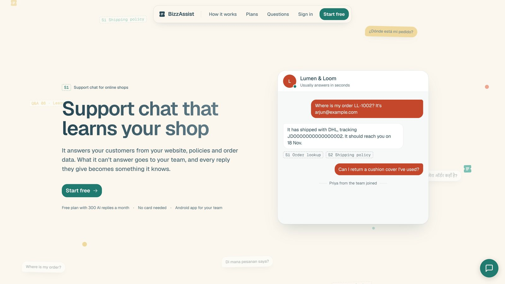

<sub>Built for the <b>Nexconn Build Challenge 2026</b> · Marketplace & Support track</sub>

</div>

<br />

---

## ✦ Why BizzAssist

A small online shop answers the same questions every day: where is my order, can I return this, do you ship to my city. Chatbots that only follow a script frustrate customers, and a full support team costs too much.

BizzAssist sits in between. The assistant answers from the shop's own information and shows where each answer came from. It hands the chat to a person when it should, and it learns from the answers that person gives, so each handover makes the next one less likely.

<br />

## ✦ See it work

<table>
<tr>
<td width="42%" valign="top">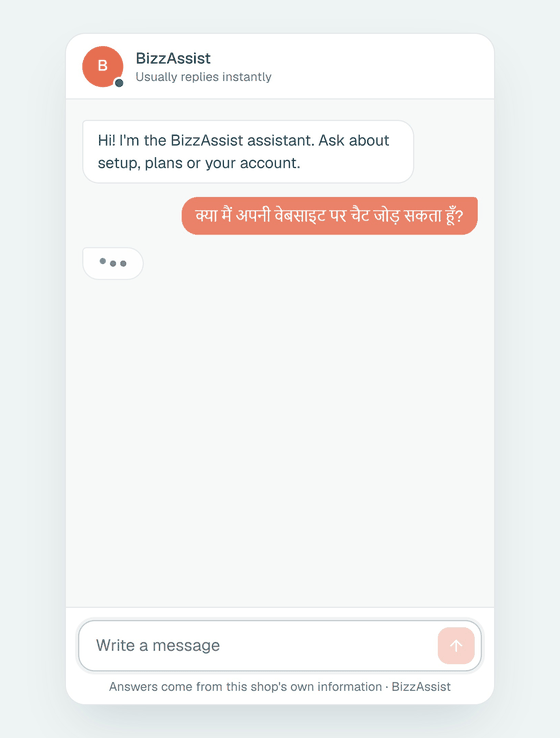<br /><sub><b>Any language</b>: Hindi, Arabic, Spanish, French, Japanese and Indonesian, each answered in kind from the same knowledge</sub></td>
<td width="58%" valign="top">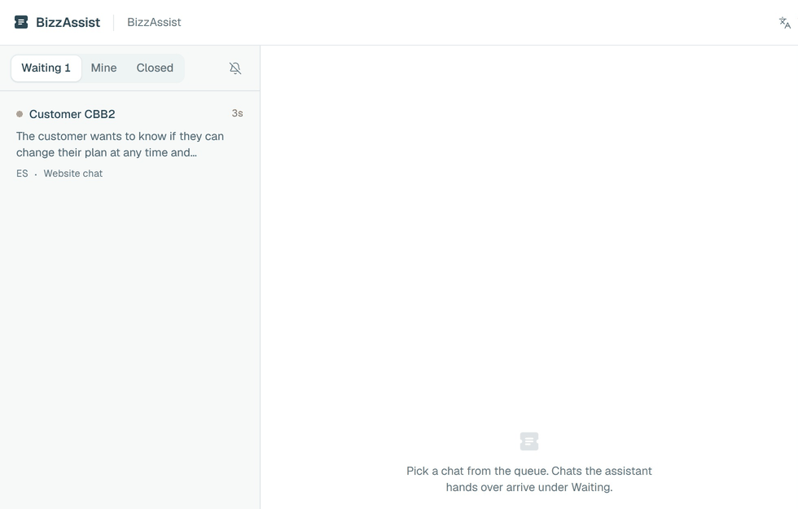<br /><sub><b>Handover</b>: a Spanish-speaking customer asks for a person. The agent gets a summary, reads a translation and replies in English</sub></td>
</tr>
</table>

<br />

## ✦ Features

| | |
|---|---|
| 🌐 **Learns from your website** | Add pages one by one or from a sitemap. Onboarding crawls the homepage, the policy pages and the top sitemap entries on its own. |
| 📄 **Documents and Q&A** | Upload PDF, TXT or Markdown, paste text, or write Q&A pairs with the other ways customers ask the same thing. |
| 🔎 **Live lookups** | API actions let the assistant check an order or an account through a REST endpoint (headers encrypted at rest) or a Google Sheet. A sheet lookup always asks for two keys, such as order ID and email, so one customer can't read another's data. |
| 🧪 **Playground** | Test the assistant before going live. Every answer shows the sources it came from. |
| 🗣️ **Every language** | The assistant answers in the language the customer writes in. Handover and status notes arrive in that language too. |
| 🙋 **Human handover** | The chat goes to a person when the customer asks for one, when the knowledge doesn't cover the question, or when the model fails. Agents get an alert, a short summary and the customer's language. |
| 🔁 **Live translation** | When the customer and the agent speak different languages, each message is translated for its reader. The original stays as written. |
| ✅ **Atomic claims** | Claiming a chat is a single database update, so two agents never take the same one. |
| 🧠 **Self-learning** | When an agent resolves a chat, their answers become suggestions. The owner approves, edits or rejects each one; approved answers are used in the next chats. |
| 🧩 **One-line install** | One script tag adds the launcher to any site, in the brand colour, with its own title, greeting and logo, limited to the business's domains. Every widget also has a direct link and a QR code. |
| 📊 **Analytics** | Share of chats solved by the assistant, average wait for a person, satisfaction, handover reasons, and the questions it couldn't answer, each with a link to add the answer. |
| 📱 **Android agent app** | Native Kotlin and Jetpack Compose app for agents: Waiting and Mine queues, claim, reply with translations, resolve, and a notification for each new waiting chat. |
| 👥 **Teams and plans** | Invite agents with one-time passwords. Free, Pro and Business plans with their limits. |

<br />

## ✦ Screens

<table>
<tr>
<td width="50%">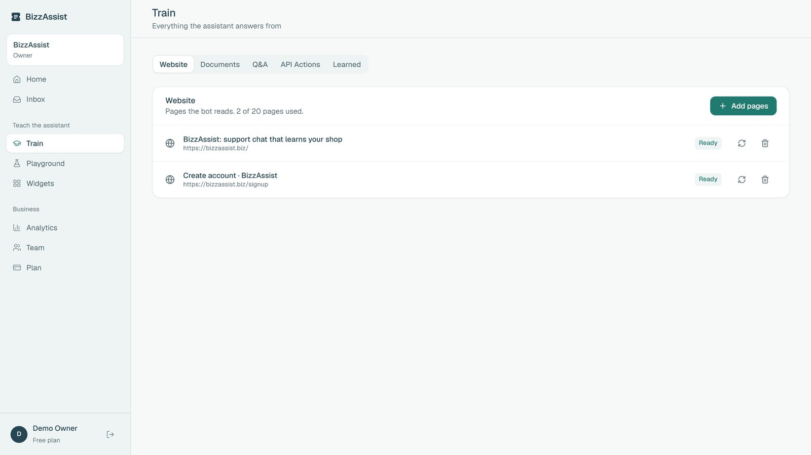<br /><sub><b>Train</b>: website pages, documents, Q&A, API actions and learned answers in one place</sub></td>
<td width="50%">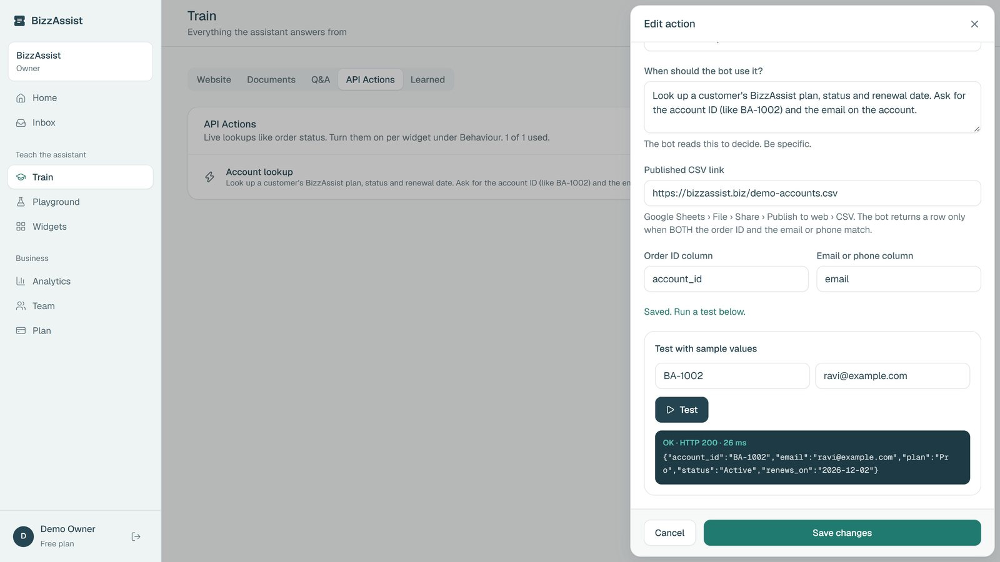<br /><sub><b>API actions</b>: connect a Google Sheet and test the lookup before saving</sub></td>
</tr>
<tr>
<td>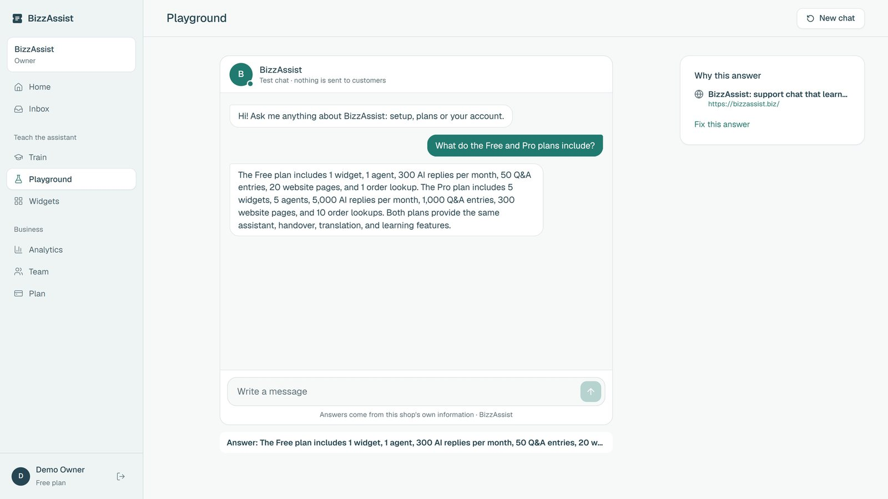<br /><sub><b>Playground</b>: try the assistant and see why it answered</sub></td>
<td>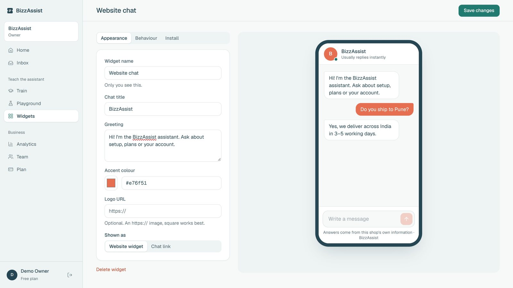<br /><sub><b>Widget editor</b>: colour, greeting and behaviour with a live preview</sub></td>
</tr>
<tr>
<td>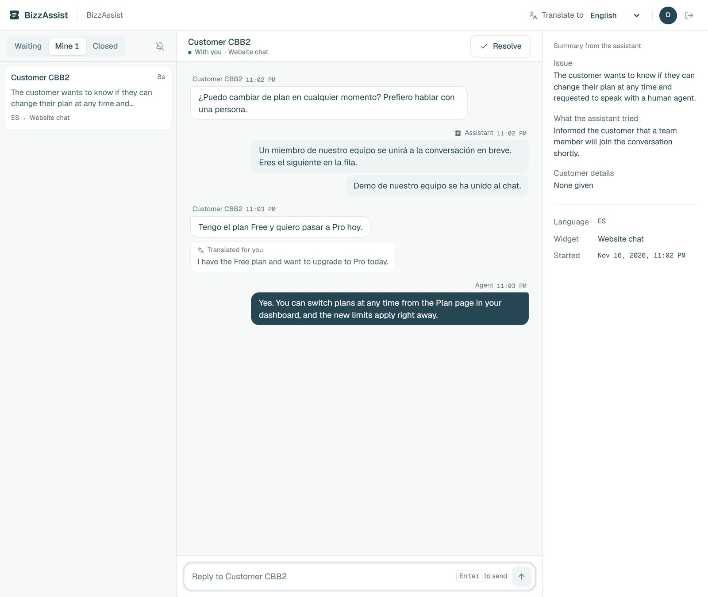<br /><sub><b>Agent inbox</b>: summary, customer language and translations side by side</sub></td>
<td>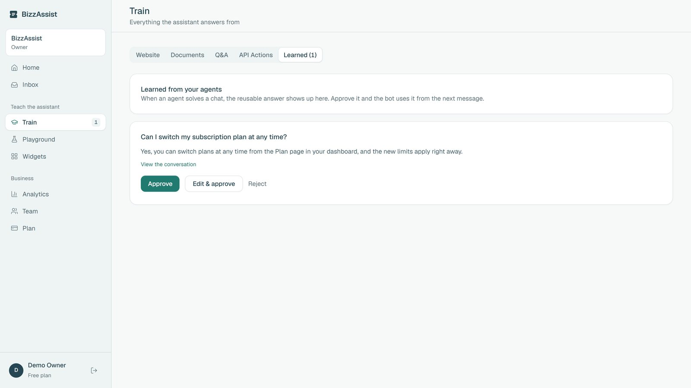<br /><sub><b>Learned</b>: an agent's answer waiting for the owner's approval</sub></td>
</tr>
<tr>
<td>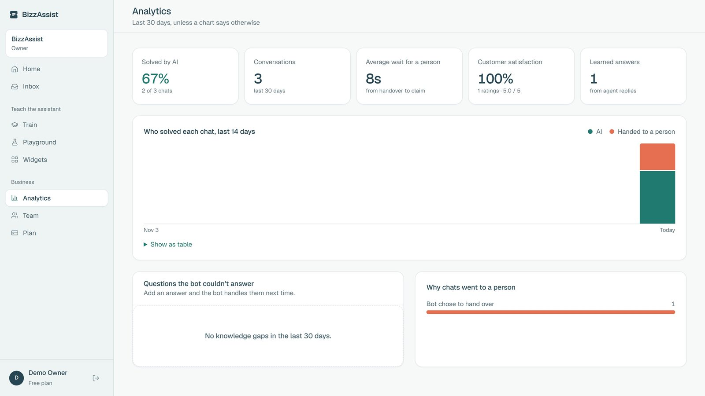<br /><sub><b>Analytics</b>: what the assistant solved and what it couldn't</sub></td>
<td align="center">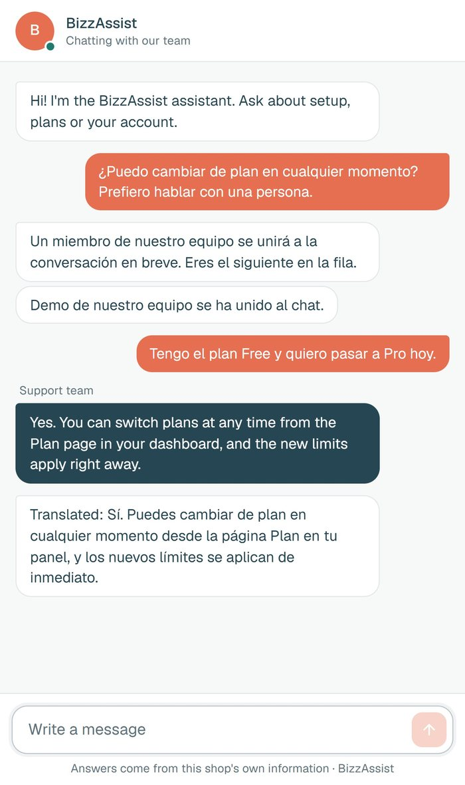<br /><sub><b>Customer view</b>: the agent's English reply, translated into Spanish</sub></td>
</tr>
</table>

<br />

## ✦ Architecture

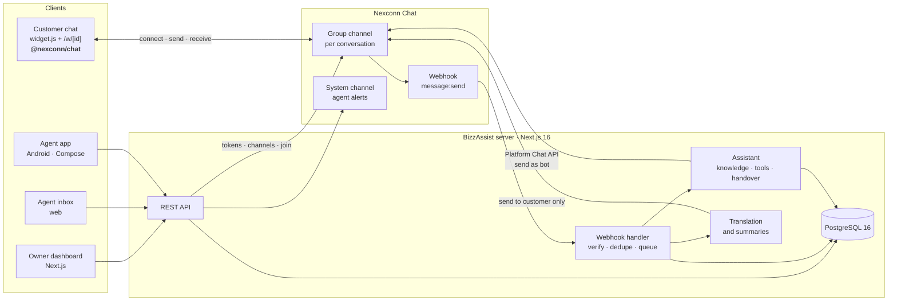

A conversation moves through four states. The customer sees each change as a note in the chat.

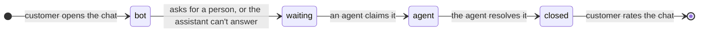

And this is how the assistant gets smarter:

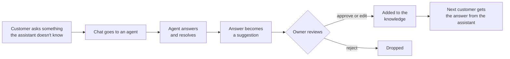

<br />

## ✦ How BizzAssist uses Nexconn

Every customer conversation in BizzAssist is a Nexconn group channel. The customer's browser talks to Nexconn through the **Nexconn Chat SDK** (`@nexconn/chat`). The BizzAssist server uses the **Nexconn Platform Chat API** to create users, channels and messages, and receives every new message through a **Nexconn webhook**. The assistant, the customer and the human agent are all real Nexconn users in the same channel.

### One conversation, end to end

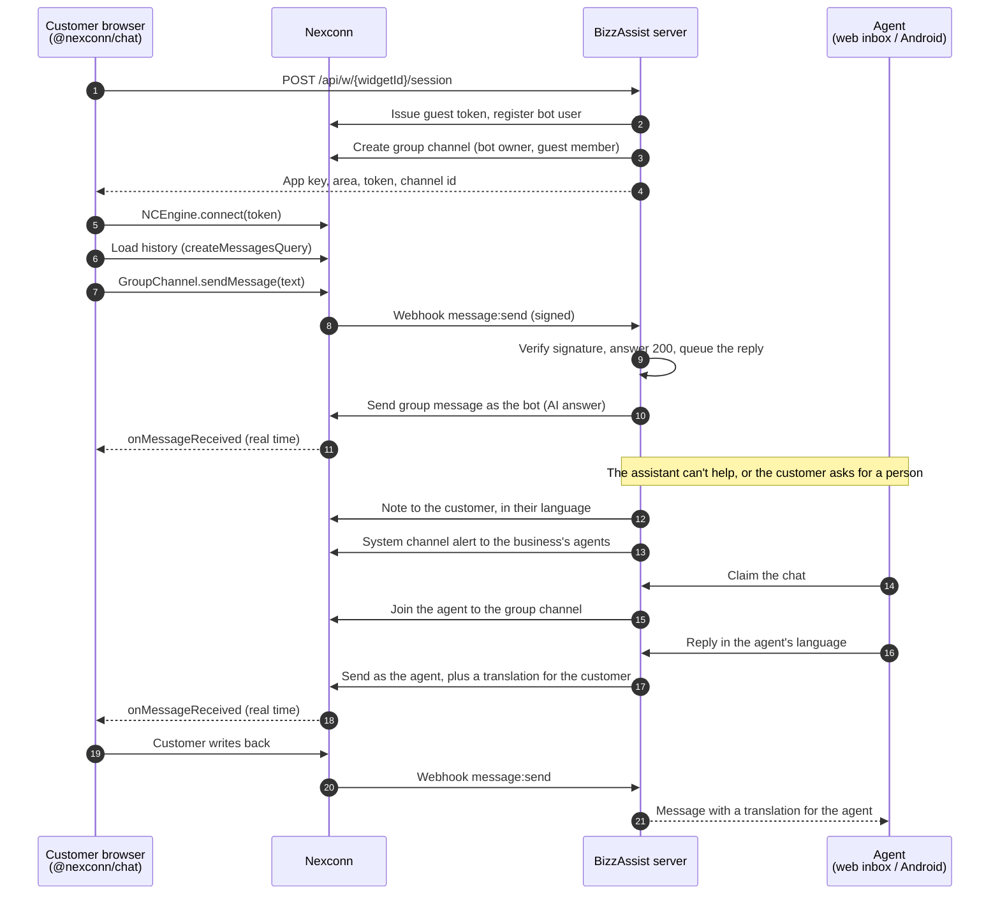

### Chat SDK on the client

The customer chat in [`web/app/w/[widgetId]/buyer-chat.tsx`](web/app/w/%5BwidgetId%5D/buyer-chat.tsx) runs on `@nexconn/chat`:

| SDK call | What it does in BizzAssist |
|---|---|
| `NCEngine.initialize({ appKey, areaCode })` | Starts the engine for the app's data center |
| `NCEngine.connect({ token })` | Signs the guest in with the token the server issued |
| `NCEngine.addConnectionStatusHandler` | Shows the connecting and offline states in the chat |
| `NCEngine.addMessageHandler` → `onMessageReceived` | Receives answers from the assistant and the agent in real time |
| `BaseChannel.createMessagesQuery` + `GroupChannelIdentifier` | Loads the conversation history when the chat reopens |
| `new GroupChannel(id).sendMessage(new SendTextMessageParams(...))` | Sends the customer's message |
| `removeMessageHandler`, `removeConnectionStatusHandler`, `disconnect` | Cleans up when the chat closes |

### Platform Chat API and webhook on the server

All server calls go through [`web/lib/nexconn.ts`](web/lib/nexconn.ts). It signs each request with the App Secret (`App-Key`, `Nonce`, `Timestamp`, `Signature`) and falls back to the backup URL of each data center.

| Nexconn endpoint | Used for | Called from |
|---|---|---|
| `POST /v4/auth/access-token/issue` | Tokens for guests, bot users and agents | [`api/w/[widgetId]/session`](web/app/api/w/%5BwidgetId%5D/session/route.ts), [`api/team`](web/app/api/team/route.ts), [`lib/conversations.ts`](web/lib/conversations.ts) |
| `POST /v4/group-channel/create` | One channel per conversation, owned by the business's bot | [`api/w/[widgetId]/session`](web/app/api/w/%5BwidgetId%5D/session/route.ts) |
| `POST /v4/group-channel/join` | Adds the agent who claims the chat | [`lib/conversations.ts`](web/lib/conversations.ts) |
| `POST /v4/group-channel/message/send` | AI answers, handover notes, agent replies, translations sent only to the customer | [`lib/ai/answer.ts`](web/lib/ai/answer.ts), [`lib/escalate.ts`](web/lib/escalate.ts), [`lib/ai/translate.ts`](web/lib/ai/translate.ts), [`api/agent/.../messages`](web/app/api/agent/conversations/%5Bid%5D/messages/route.ts) |
| `POST /v4/system-channel/message/send` | New-chat alert to the business's agents | [`lib/escalate.ts`](web/lib/escalate.ts) |
| Webhook `message:send` | Every customer message reaches the server | [`api/nexconn/webhook`](web/app/api/nexconn/webhook/route.ts) |

The webhook handler checks the signature with a timing-safe compare and drops repeated deliveries. It answers within Nexconn's 5-second window and does the AI work afterwards, so Nexconn never has to retry.

### What Nexconn does for us

- **Real-time delivery.** Messages reach the customer through the SDK connection. We didn't build or host a WebSocket server.
- **Users and channels.** Customers, bots and agents are Nexconn users, and each conversation is a group channel. A person joining is a channel join, and the history stays with the channel.
- **One channel for AI and people.** The assistant and the agent post into the same channel, so the customer never switches screens when a person takes over.
- **Messages for one reader.** `toUserIds` sends a translation only to the customer, while the agent sees the original.
- **Alerts.** System channel messages tell agents a chat is waiting.
- **Webhooks.** Every customer message arrives signed at one endpoint, and that endpoint drives the AI answers, translations, analytics and the agent inbox.
- **Data centers.** One setting (`NEXCONN_AREA`: SG, NA or SA) points the SDK and the server at the same region.

<br />

## ✦ Repository layout

```
web/       Next.js app: landing page, owner dashboard, agent inbox, customer chat, API and Nexconn webhook
  app/       routes and pages
  lib/       auth, Nexconn client, AI answering, translation, ingestion, plans
  db/        Postgres schema, applied at server start
  public/    widget.js, the embeddable launcher
  tests/     unit tests
android/   agent app in Kotlin and Jetpack Compose
deploy/    Docker Compose (Postgres, web, Caddy), deploy, backup and firewall scripts
.github/   README images
```

A prebuilt agent app is at `BizzAssist-Agent.apk`. It connects to bizzassist.biz.

<br />

## ✦ Tech stack

- Next.js 16 and React 19, TypeScript, Tailwind CSS 4
- PostgreSQL 16 through `postgres`
- Nexconn Chat: `@nexconn/chat` on the web, the Nexconn server API for bot and agent messages, webhooks for incoming messages
- Google AI Studio models through `@google/genai` for answers, summaries, translation and learning
- `unpdf` for PDF text
- Android: Kotlin, Jetpack Compose with Material 3, Retrofit, kotlinx.serialization, DataStore
- Docker Compose and Caddy (automatic HTTPS) on a single Ubuntu server

<br />

## ✦ Run locally

Needs Node 22 and a Postgres 16 database.

```bash
cd web
npm install
cp ../deploy/.env.example .env.local   # set DATABASE_URL, APP_URL and the Nexconn and model keys
npm run dev
```

The Nexconn webhook has to reach the app over public HTTPS. For local work, start a tunnel such as `cloudflared tunnel --url http://localhost:3000` and set the tunnel URL plus `/api/nexconn/webhook` as the webhook URL in the Nexconn console.

Other scripts:

```bash
npm test            # unit tests
npm run typecheck
npm run lint
npm run seed        # demo business with an owner and an agent; prints their logins once
```

The claim race test needs a throwaway database: `RUN_DB_TESTS=1 DATABASE_URL=postgres://... npm test`.

<br />

## ✦ Configuration

All settings live in `deploy/.env` (copy `deploy/.env.example`).

| Variable | What it is |
|---|---|
| `DOMAIN` | Hostname Caddy gets a certificate for |
| `POSTGRES_PASSWORD` | Database password, letters and digits only |
| `NEXCONN_APP_KEY`, `NEXCONN_APP_SECRET`, `NEXCONN_AREA` | From the Nexconn console. The area must match the app's data center |
| `LLM_API_KEY` | Google AI Studio API key |
| `LLM_MODEL_MAIN`, `LLM_MODEL_LITE` | Model ids. Main answers customers; lite handles translation, summaries and learning |
| `APP_ENCRYPTION_KEY` | 64 hex characters, encrypts API action headers |
| `DEMO_PASSWORD` | Optional fixed password for the seeded demo accounts |
| `STATS_EXCLUDE_BUSINESSES` | Optional comma-separated business ids left out of the public stats page |

<br />

## ✦ Deploy

The production server runs Ubuntu with Docker and Docker Compose.

```bash
git clone https://github.com/PocketForgee/Bizz-Assist.git && cd Bizz-Assist/deploy
cp .env.example .env    # fill it in
./open-ports.sh         # opens 80 and 443 and keeps them across reboots
docker compose up -d --build
```

Then in the Nexconn console set the webhook URL to `https://<DOMAIN>/api/nexconn/webhook` and subscribe to `message:send`.

For later updates, run `./deploy.sh` from `deploy/`. It pulls, builds the new image while the old one keeps serving, swaps the containers and waits until the app answers. `backup.sh` takes a nightly database dump; the cron line is at the top of the file.

<br />

## ✦ Android agent app

Download the prebuilt app: [`BizzAssist-Agent.apk`](BizzAssist-Agent.apk). It connects to bizzassist.biz.

The app is for the people who answer chats. Sign in with the email and temporary password the owner created in Team, see the Waiting and Mine queues, claim a chat, reply with a translation shown under each customer message, and resolve it. New waiting chats raise a notification.

Building it needs JDK 17 or newer and the Android SDK (API 36):

```bash
cd android
./gradlew assembleRelease
```

To point it at your own server, copy `local.properties.example` to `local.properties` and set `bizzassist.apiBaseUrl`. More in [android/README.md](android/README.md).

---

<div align="center">


<sub><b>BizzAssist</b> · built on Nexconn Chat · <a href="https://bizzassist.biz">bizzassist.biz</a></sub>

</div>
